<picture>
  <source media="(prefers-color-scheme: dark) and (max-width: 600px)" srcset="assets/terminal-dark-mobile.svg">
  <source media="(prefers-color-scheme: dark)" srcset="assets/terminal-dark.svg">
  <source media="(max-width: 600px)" srcset="assets/terminal-light-mobile.svg">
  
</picture>

  
  
  

**王誉凯 · SJTU** — Dual degrees in **Computer Science & Bioinformatics** · Expected June 2027 · Shanghai, China.

### `$ cat toolkit.txt`

| Area | Project toolkit |
| :--- | :--- |
| **Languages & web** |       |
| **ML & data** |     |
| **LLM & retrieval** |    |
| **Build & tools** |        |

### `$ ls selected-work/`

| Work | Focus & links |
| :--- | :--- |
| **SMMBench** · Research | Source-distributed multimodal agent memory benchmark. [Paper](https://arxiv.org/abs/2605.15710) · [Code](https://github.com/FatCatCHC/SMMBench) · [Data](https://huggingface.co/datasets/HuacanChai/SMMBench) |
| **REALM** · Research | Retrieval-driven memory reconsolidation for long-term LLM agents. [Paper](https://arxiv.org/abs/2609.16053) |
| [**TrustRAG**](https://github.com/wangyukai585/trustrag) | Hybrid retrieval + self-critique for document Q&A. `LangChain` `ChromaDB` |
| [**BioAlgoDB**](https://github.com/wangyukai585/BioAlgoDB) | A searchable bioinformatics algorithms database. `Vue` `Flask` `MySQL` |
| [**ML fundamentals**](https://github.com/wangyukai585/SE3332-lab1) | Logistic regression, SVM, and MLP experiments. `NumPy` `PyTorch` |

### `$ ./contributions --animate`

<picture>
  <source media="(prefers-color-scheme: dark)" srcset="assets/github-snake-dark.svg">
  
</picture>

  
Appearance credits

Inspired by [beautiful-github-profile](https://github.com/sissc0731/beautiful-github-profile). Badges by [Shields.io](https://shields.io/), with logos from [Simple Icons](https://simpleicons.org/). Contribution animation by [Platane/snk](https://github.com/Platane/snk). Terminal artwork and typing animation are custom SVGs hosted in this repository.

